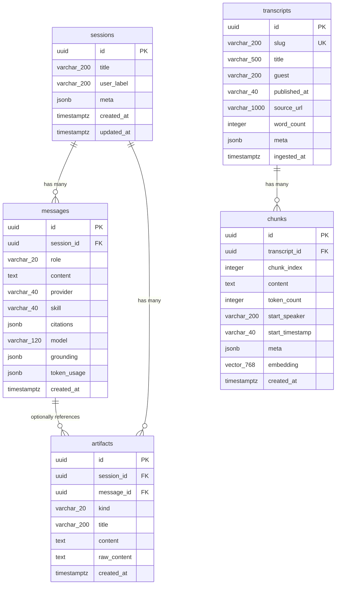

# Lenny Growth Assistant V2 — Architecture Specification

## 1. System Overview

**Lenny Growth Assistant V2** is a modular, production-grade AI research and growth assistant. It couples high-precision semantic retrieval over *Lenny's Podcast* transcripts with general conversational reasoning, multi-turn constraint enforcement, and sandboxed artifact rendering.

The system is partitioned into three decoupled tiers:
- **Frontend**: React 19 + TypeScript + Vite 8 SPA providing a Canvas Studio interface, real-time Server-Sent Events (SSE) consumption, responsive navigation, and sandboxed iframe rendering.
- **Backend**: FastAPI (Python 3.12) async service orchestrating PostgreSQL/pgvector persistence, transcript chunking and vector embedding, internal retrieval APIs, session lifecycle, and server-side content sanitization.
- **Agent Service**: Node.js 24 + TypeScript runtime utilizing `@earendil-works/pi-coding-agent` with local Ollama models (`llama3.2:3b` and `nomic-embed-text`), heuristic turn routing, constraint extraction, and streaming NDJSON protocol.

---

## 2. End-to-End System Architecture Diagram

```mermaid
flowchart TB
    subgraph Client ["Frontend Tier (Port 5173)"]
        UI["React 19 + Vite UI\n(App, Composer, MessageBubble)"]
        AV["ArtifactViewer\n(Iframe sandbox='', strict CSP)"]
        SSE["SSE Buffer Parser\n(/sessions/{id}/chat)"]
    end

    subgraph Backend ["FastAPI Backend (Port 8000)"]
        API["FastAPI Routes\n(/sessions, /artifacts, /health, /config)"]
        IR["Internal Retrieval Endpoint\n(POST /internal/retrieve [Token Auth])"]
        SAN["Sanitizer\n(Python Bleach HTML/MD Whitelist)"]
        CH["Chunker & Ingestion Engine\n(nomic-embed-text 768-dim)"]
    end

    subgraph AgentRuntime ["Agent Service (Port 8001)"]
        AS["Node.js / Express Server\n(POST /chat, /essay, /artifact)"]
        ROUTE["Routing Engine\n(routing.ts -> general | transcript | follow_up)"]
        CONST["Constraint Engine\n(constraints.ts -> time, budget, maturity)"]
        PI["Pi Coding Agent Runtime\n(@earendil-works/pi-coding-agent)"]
        TOOL["search_transcripts Tool"]
    end

    subgraph Persistence ["Persistence & Vector Store (Port 5432)"]
        PG[(PostgreSQL 16/17 + pgvector)]
        T_SESS["sessions"]
        T_MSG["messages"]
        T_TRANS["transcripts"]
        T_CHUNK["chunks (vector 768)"]
        T_ART["artifacts"]
    end

    subgraph LocalLLM ["Local Inference Engine (Port 11434)"]
        OLLAMA["Ollama Server"]
        M_GEN["llama3.2:3b (Chat / Reasoning)"]
        M_EMB["nomic-embed-text:latest (Embeddings)"]
    end

    %% Data Flow Connections
    UI -->|User prompt| API
    API -->|Persist user message| T_MSG
    API -->|Stream request (NDJSON)| AS
    AS --> ROUTE
    ROUTE -->|Analyze context| CONST
    CONST --> PI

    PI -.->|If route == 'transcript'| TOOL
    TOOL -->|Bearer INTERNAL_TOKEN| IR
    IR -->|Embed query| M_EMB
    IR -->|Cosine distance search| T_CHUNK
    T_CHUNK -->|Top K chunks + scores| IR
    IR -->|Grounding result| TOOL

    PI -->|Generate tokens| M_GEN
    M_GEN -->|Token stream| PI
    PI -->|NDJSON stream (tokens, citations, artifacts)| AS
    AS -->|Stream response| API
    API -->|Sanitize & persist turn / artifacts| SAN
    SAN --> T_ART
    API -->|SSE stream| SSE
    SSE --> UI
    T_ART -->|Render in isolated iframe| AV
```

---

## 3. Data Flow & Execution Lifecycle

### 3.1 Normal Conversation Turn
1. **User Action**: The user submits a prompt via `<Composer />` in the React frontend.
2. **FastAPI Dispatch**: The frontend initiates an SSE request to `POST /sessions/{session_id}/chat`.
3. **Session Verification & Persistence**: FastAPI checks that the session exists in PostgreSQL, loads historical turns for conversation context, and persists the new user message.
4. **Agent Invocation**: FastAPI opens an HTTP streaming connection to `POST /chat` on the Agent Service.
5. **Turn Routing (`routing.ts`)**:
   - The Agent Service evaluates the prompt and preceding messages.
   - **Transcript Route**: Queries containing guest names (e.g., Jason Cohen, Elena Verna), podcast keywords, or specific growth frameworks activate the `search_transcripts` tool.
   - **General Route**: Questions regarding programming (Java, Python), productivity, general knowledge, or casual interaction deactivate tools, directing the model to answer naturally.
   - **Follow-up Route**: Queries requesting summaries, applications, or examples of the immediately prior turn deactivate tools to prevent cross-guest retrieval drift.
6. **Constraint Analysis (`constraints.ts`)**:
   - Explicit caps (e.g., 60-hour total time budget, ₹10,000 spend limit, unbuilt product phase) are extracted and injected as hard system directives.
7. **Tool Execution (if enabled)**:
   - When the agent invokes `search_transcripts`, it calls `POST /internal/retrieve` on the FastAPI backend, authenticated with a pre-shared `INTERNAL_TOKEN`.
   - FastAPI generates a 768-dimensional embedding via Ollama (`nomic-embed-text`) and performs cosine distance retrieval in pgvector.
   - Chunks meeting similarity thresholds are returned with speaker, timestamp, and episode metadata.
8. **Streaming & Event Emission**:
   - The Agent Service streams NDJSON events (`token`, `citation`, `grounding`, `artifact`).
   - FastAPI translates NDJSON events into Server-Sent Events (`data: {...}\n\n`).
   - If grounding is false or similarity is below threshold, citations are suppressed.
9. **Final Persistence**:
   - Upon completion, FastAPI persists the assistant's message, citations, grounding metadata, and token usage into the `messages` table.

---

## 4. Database Schema (Alembic Head `0003_message_telemetry`)

The database is built on PostgreSQL with the `pgvector` extension. All primary keys are native PostgreSQL `UUID` values.



### Table Definitions

| Table | Columns | Constraints & Indexes | Purpose |
| :--- | :--- | :--- | :--- |
| `sessions` | `id` (UUID), `title` (VARCHAR 200), `user_label` (VARCHAR 200), `meta` (JSONB), `created_at` (TIMESTAMPTZ), `updated_at` (TIMESTAMPTZ) | PK(`id`) | Stores top-level conversation threads. |
| `messages` | `id` (UUID), `session_id` (UUID), `role` (VARCHAR 20), `content` (TEXT), `provider` (VARCHAR 40), `skill` (VARCHAR 40), `citations` (JSONB), `model` (VARCHAR 120), `grounding` (JSONB), `token_usage` (JSONB), `created_at` (TIMESTAMPTZ) | PK(`id`), FK(`session_id` → `sessions.id` CASCADE), IDX(`session_id`) | Persists turns, tool telemetry, citations, and model usage. |
| `transcripts` | `id` (UUID), `slug` (VARCHAR 200), `title` (VARCHAR 500), `guest` (VARCHAR 200), `published_at` (VARCHAR 40), `source_url` (VARCHAR 1000), `word_count` (INT), `meta` (JSONB), `ingested_at` (TIMESTAMPTZ) | PK(`id`), UNIQUE(`slug`) | Metadata for ingested Lenny's Podcast episodes. |
| `chunks` | `id` (UUID), `transcript_id` (UUID), `chunk_index` (INT), `content` (TEXT), `token_count` (INT), `start_speaker` (VARCHAR 200), `start_timestamp` (VARCHAR 40), `meta` (JSONB), `embedding` (VECTOR 768), `created_at` (TIMESTAMPTZ) | PK(`id`), FK(`transcript_id` → `transcripts.id` CASCADE), IDX(`transcript_id`, `chunk_index`) | Slices of transcripts with 768-dim nomic embeddings. |
| `artifacts` | `id` (UUID), `session_id` (UUID), `message_id` (UUID), `kind` (VARCHAR 20), `title` (VARCHAR 200), `content` (TEXT), `raw_content` (TEXT), `created_at` (TIMESTAMPTZ) | PK(`id`), FK(`session_id` → `sessions.id` CASCADE), FK(`message_id` → `messages.id` SET NULL) | Rendered deliverables (markdown/html) tied to a session. |

---

## 5. API Endpoints Catalog

### 5.1 FastAPI Backend Endpoints (Port 8000)

| Method | Path | Auth | Description | Request Body / Params | Response |
| :--- | :--- | :--- | :--- | :--- | :--- |
| `GET` | `/` | None | Service identification & root meta | None | `{"service": "...", "version": "...", "docs": "/docs"}` |
| `GET` | `/health` | None | System & dependency health check | None | `HealthResponse` (status, db, agent, ollama) |
| `GET` | `/config` | None | Client configuration parameters | None | `ClientConfig` (message limits, defaults) |
| `GET` | `/sessions` | None | List recent sessions (limit: 50) | `?limit=50` | `list[SessionSummary]` |
| `POST` | `/sessions` | None | Create a new conversation session | `SessionCreate` (optional user_label, meta) | `SessionSummary` (201 Created) |
| `GET` | `/sessions/{id}` | None | Retrieve specific session summary | Path `id: UUID` | `SessionSummary` |
| `PATCH` | `/sessions/{id}` | None | Rename or update session metadata | `SessionUpdate` (`title: str`) | `SessionSummary` |
| `DELETE` | `/sessions/{id}` | None | Delete session and cascade messages | Path `id: UUID` | `204 No Content` |
| `GET` | `/sessions/{id}/messages` | None | Fetch all messages in a session | Path `id: UUID` | `list[MessageRead]` |
| `POST` | `/sessions/{id}/chat` | None | Stream chat turn via SSE | `ChatTurnRequest` (`content`, `skill`) | `text/event-stream` (SSE events) |
| `GET` | `/sessions/{id}/artifacts` | None | List artifacts generated for session | Path `id: UUID` | `list[ArtifactSummary]` |
| `POST` | `/artifacts` | None | Save a sanitized artifact | `ArtifactCreate` (`kind`, `title`, `content`) | `ArtifactRead` (201 Created) |
| `GET` | `/artifacts/{id}` | None | Fetch single artifact by ID | Path `id: UUID` | `ArtifactRead` |
| `POST` | `/internal/retrieve` | Bearer Token | Internal semantic vector search | `RetrievalRequest` (`query`, `limit`, `guest`) | `RetrievalResponse` (chunks, scores, grounded) |

### 5.2 Agent Service Endpoints (Port 8001)

| Method | Path | Protocol | Description |
| :--- | :--- | :--- | :--- |
| `GET` | `/health` | JSON | Agent runtime status, uptime, and memory usage. |
| `POST` | `/chat` | NDJSON Stream | Executes conversation turn, handles tool calls, yields streamed chunks. |
| `POST` | `/essay` | NDJSON Stream | Ship 30 for 30 structured essay generation turn. |
| `POST` | `/artifact` | NDJSON Stream | Generates structured artifact deliverables with metadata. |

---

## 6. Retrieval Pipeline & Grounding Verification

### 6.1 Chunking & Vectorization
- **Chunk Size**: Target 400 tokens (~1,600 characters) with 50-token overlapping windows.
- **Metadata Preservation**: Every chunk retains `start_speaker` and `start_timestamp` (`[HH:MM:SS]`) from the transcript source.
- **Embedding Model**: `nomic-embed-text:latest` via Ollama API (`/api/embeddings`), producing 768-dimensional normalized vectors.

### 6.2 Semantic Search
- Retrieval is performed using pgvector's cosine distance operator `<=>`:
  ```sql
  SELECT c.id, c.content, c.start_speaker, c.start_timestamp, t.title, t.guest, t.source_url,
         1 - (c.embedding <=> :query_vector) AS similarity
  FROM chunks c
  JOIN transcripts t ON c.transcript_id = t.id
  ORDER BY c.embedding <=> :query_vector ASC
  LIMIT :limit;
  ```
- **Grounding Classification**:
  - `min_score` threshold is calibrated at `0.35` (empirically, high-relevance matches score `0.60` to `0.78`).
  - If the top result similarity is below `0.35`, the response is classified as `grounded: false`.
  - In `grounded: false` states, citation wire events are suppressed, and the user interface displays the ungrounded indicator without fabricated source cards.

---

## 7. Transcript Source Rationale

### The Question: Why use `LennysNewsletter/lennys-newsletterpodcastdata` instead of alternative repositories?

The project ingests transcripts from the official starter dataset repository (`LennysNewsletter/lennys-newsletterpodcastdata`) using `scripts/fetch_transcripts.sh`. This architectural choice is driven by three essential factors:

1. **Licensing & Copyright Compliance**:
   - Lenny's Podcast transcripts are protected intellectual property. Lenny Rachitsky's official terms grant personal, non-commercial use for research while prohibiting raw redistribution in public git repositories.
   - Committing hundreds of raw transcript markdown files into a public repository violates redistribution terms. Instead, our project implements an automated, reproducible fetch script (`scripts/fetch_transcripts.sh`) that clones the data locally and adds `data/transcripts/` to `.gitignore`. This satisfies both reproducibility and legal licensing compliance.

2. **Clean Structural Frontmatter & Metadata Integrity**:
   - Alternative community scrapers often mangle speaker names, omit timestamps, or produce messy HTML artifacts.
   - The official dataset maintains consistent YAML frontmatter (`title`, `guest`, `date`, `url`) and standardized speaker markers:
     ```markdown
     **Lenny** (00:01:23): Welcome to the show.
     **Jason Cohen** (00:01:45): Thanks for having me, Lenny.
     ```
   - This allows our chunker (`backend/app/services/chunker.py`) to extract exact speaker attribution and minute-second timestamps without brittle regular expressions.

3. **Deterministic Retrieval & Reliable Audio Anchors**:
   - Because timestamps match the published podcast recordings, source citations rendered in the UI can direct users to the precise audio moment in the episode, creating a verified chain of custody for every claim.

---

## 8. Security, Sandboxing & Sanitization

The architecture employs defense-in-depth across both backend and frontend layers:

1. **Server-Side HTML Sanitization (`backend/app/services/content_sanitizer.py`)**:
   - All generated artifact content is processed through Python `bleach`.
   - Restricts tags to an allowed whitelist (`h1-h6`, `p`, `a`, `ul`, `ol`, `li`, `strong`, `em`, `code`, `pre`, `blockquote`, `table`, `thead`, `tbody`, `tr`, `th`, `td`).
   - Disallows `<script>`, `<iframe>`, `<object>`, `<embed>`, `<form>`, `<style>`, and all `on*` event handlers.
   - Restricts protocols to `http`, `https`, and `mailto`.

2. **Client-Side Double Sanitization (`frontend/src/components/ArtifactViewer.tsx`)**:
   - Before insertion into the DOM, content is parsed via `marked` and sanitized using `DOMPurify`.
   - Explicitly forbids dangerous elements and execution attributes:
     ```typescript
     DOMPurify.sanitize(content, {
       FORBID_TAGS: ["script", "form", "meta", "base", "object", "embed", "iframe"],
       FORBID_ATTR: ["onerror", "onload", "onclick", "onmouseover", "onkeydown", "onkeyup", "onkeypress"],
       ALLOW_DATA_ATTR: false,
     });
     ```

3. **Iframe Sandboxing & Content Security Policy (CSP)**:
   - The `<ArtifactViewer />` renders content within an `<iframe>` equipped with `sandbox=""` (disallowing script execution, form submissions, popups, and same-origin cookies).
   - An inline CSP is embedded in the frame's `srcDoc`:
     ```html
     <meta http-equiv="Content-Security-Policy" content="default-src 'none'; style-src 'unsafe-inline'; font-src 'self'; img-src data: https:;">
     ```

4. **Internal Route Authentication**:
   - The internal vector retrieval route (`POST /internal/retrieve`) requires a Bearer token matching `INTERNAL_TOKEN` (`dev-internal-token` in development), preventing unauthorized vector queries from external clients.

---

## 9. Deployment & Orchestration

The application is fully containerized via `docker-compose.yml`:

```yaml
services:
  db:
    image: pgvector/pgvector:pg16
    ports: ["5432:5432"]
    environment:
      POSTGRES_USER: lenny
      POSTGRES_PASSWORD: lenny
      POSTGRES_DB: lenny_growth
    volumes: [postgres_data:/var/lib/postgresql/data]

  backend:
    build: { context: ./backend, dockerfile: Dockerfile }
    ports: ["8000:8000"]
    depends_on: [db]
    environment:
      DATABASE_URL: postgresql+asyncpg://lenny:lenny@db:5432/lenny_growth
      AGENT_SERVICE_URL: http://agent-service:8001
      INTERNAL_TOKEN: dev-internal-token
      OLLAMA_BASE_URL: http://host.docker.internal:11434

  agent-service:
    build: { context: ./agent-service, dockerfile: Dockerfile }
    ports: ["8001:8001"]
    environment:
      PORT: 8001
      INTERNAL_TOKEN: dev-internal-token
      BACKEND_URL: http://backend:8000
      OLLAMA_BASE_URL: http://host.docker.internal:11434

  frontend:
    build: { context: ./frontend, dockerfile: Dockerfile }
    ports: ["5173:5173"]
    depends_on: [backend]
```

### Resource Requirements & Prerequisites
- **Local LLM Server**: Ollama running on host (`http://localhost:11434`).
- **Models Pulled**:
  - `ollama pull llama3.2:3b` (~2.0 GB)
  - `ollama pull nomic-embed-text:latest` (~274 MB)
- **Memory Footprint**: ~4 GB RAM total (including Ollama models in VRAM/RAM, PostgreSQL, and services).
